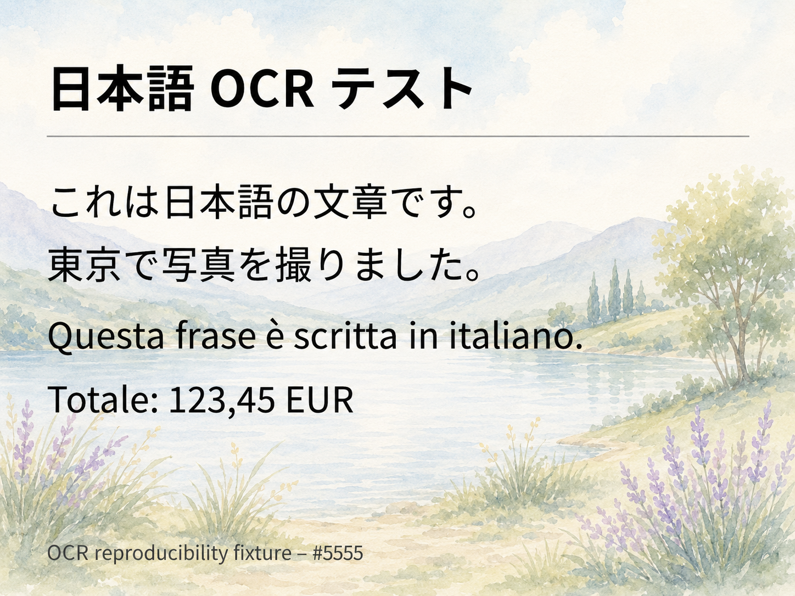
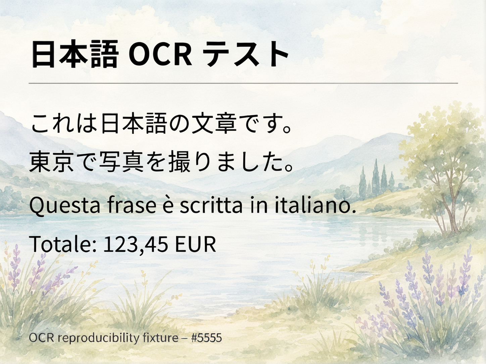

# remove-ai-watermarks-low-vram

An unofficial, Linux-focused low-VRAM adaptation of
[wiltodelta/remove-ai-watermarks](https://github.com/wiltodelta/remove-ai-watermarks),
tested on a legacy NVIDIA GeForce GTX 1050 with 4 GB of VRAM.

This repository retains the upstream command-line application and adds three
safe Bash entry points, a reproducible installer, a true face-free mode, and an
experimental OCR-guided path that protects small text. The original image is
never overwritten.

> [!IMPORTANT]
> This is an independent derivative, not an official upstream release and not
> affiliated with OpenAI, Google DeepMind, or any model provider. Use it only on
> files you own or are authorized to modify.

## Why this fork exists

The upstream project has a high-quality Qwen/Z-Image pipeline, but its complete
model stack is too large for older GPUs. This fork makes the useful SDXL global
regeneration stage practical on a 4 GB card by adding:

- sequential CPU offload, maximum attention slicing, and VAE slicing/tiling;
- reuse of complete model components from selective Hugging Face cache snapshots;
- a switch that skips face detection and face refinement completely, avoiding
  YuNet, SAM, and the very large Z-Image face model;
- full-resolution processing by default (`--max-resolution 0`);
- JPEG quality 100 with 4:4:4 chroma when a JPEG must be re-saved;
- optional OCR, LaMa, and crop-based Qwen-VAE restoration for small writing.

The motivation is practical user control over files and more accurate treatment
of mixed creative workflows, where AI can be one tool in a larger human process.
Removing a provenance signal must not be used to misrepresent authorship or
deceive others.

## The three Bash commands

| Command | Face stage | Small-text restoration | Default suffix | Recommended use |
|---|---:|---:|---|---|
| `cleanImage.sh` | Yes | No | `_cleaned` | Complete pipeline on hardware with substantially more VRAM and storage. It may fetch tens of additional gigabytes of face-model data and is not the 4 GB path. |
| `cleanImageNoFace.sh` | No | No | `_cleaned` | Recommended general-purpose path for a 4 GB legacy GPU. It performs only the global SDXL regeneration. |
| `cleanImageNoFaceText.sh` | No | Yes | `_cleaned_text` | Experimental 4 GB path for images containing small text. It also writes a `.text-report.json` sidecar. |

`cleanImageNoFaceText.sh` deliberately ignores OCR lines taller than 10% of the
image because large, integrated lettering is usually preserved well by the SDXL
stage. For selected small lines, PaddleOCR compares the source with the scrubbed
candidate, LaMa removes damaged glyph pixels, and only the compact Qwen VAE
reconstructs context-rich crops. The roughly 57 GiB full Qwen transformer is
neither loaded nor downloaded by this path.

## Tested hardware and software

The working reference machine is intentionally modest:

| Component | Tested configuration |
|---|---|
| GPU | NVIDIA GeForce GTX 1050, 4 GB VRAM, compute capability 6.1 |
| CPU | Intel Core i7-7700HQ |
| RAM | 16 GiB |
| OS | Linux Mint 22 |
| Python | 3.12.3 |
| NVIDIA driver | 580.173.02 |
| PyTorch | 2.5.1 + CUDA 12.4 |

The global regeneration pipeline is CUDA-only. A system CUDA toolkit is not
required by the installer, but a compatible NVIDIA GPU and driver are.

## Installation

Install Git, Python 3.11 or 3.12 with `venv` support, and a working NVIDIA driver,
then run:

```bash
git clone https://github.com/jsfan3/remove-ai-watermarks-low-vram.git
cd remove-ai-watermarks-low-vram
./install.sh
```

The installer explains the expected transfer and asks before downloading. Use
`./install.sh --yes` for a non-interactive installation, or `--no-text` to omit
the isolated PaddleOCR environment.

No model weights are stored in this Git repository. They are downloaded
automatically on first use and cached in the standard Hugging Face and PaddleX
locations. Measured footprints on the reference machine were:

| Local component | Approximate cache/storage |
|---|---:|
| SDXL base model | 6.4 GiB |
| SDXL Canny ControlNet | 2.4 GiB |
| SDXL VAE | 0.32 GiB |
| SDXL-Lightning LoRA | 0.38 GiB |
| Qwen VAE subset used for text | 0.24 GiB |
| LaMa | 0.20 GiB |
| PaddleOCR models | 0.23 GiB |
| Main and OCR Python environments | 7.7 GiB |

Allow roughly 15 GB of network transfer from an empty cache and at least 25 GiB
of free disk space. These are measured estimates, not fixed upstream sizes; model
revisions and Python wheels can change them. The face-free workflow occupies
about 18 GiB after installation and first use.

## Usage

For a normal image on a 4 GB GPU:

```bash
./cleanImageNoFace.sh image.png
```

For an image with small writing:

```bash
./cleanImageNoFaceText.sh image.png
```

Multiple files and ordinary Bash wildcards are supported:

```bash
./cleanImageNoFace.sh *.jpg *.png
./cleanImageNoFaceText.sh --strength 0.10 scans/*.png
```

The conservative default strength is `0.15`. Accepted values range from `0.05`
(least visual change) to `1.00` (most visual change). Lower values better preserve
fine detail but may be less effective; the correct setting must be verified for
each source. Use `--suffix` to choose another output suffix:

```bash
./cleanImageNoFace.sh --suffix _scrubbed --strength 0.10 "my image.jpg"
```

Run `--help` on any Bash command for all supported options. The scripts:

- keep the source file unchanged and verify its SHA-256 before publishing output;
- refuse to overwrite an existing output or report;
- work in a temporary file and move it into place only after successful processing;
- remove all supported metadata after pixel regeneration;
- run the upstream `identify` command before and after processing.

An `unknown` result from the bundled detector does **not** prove that SynthID is
absent. When a provider-specific verifier exists, use it on the exact original
and output files.

## ChatGPT/SynthID example

The repository author generated the input fixture with ChatGPT and processed it
with the text-preserving face-free workflow. Both documentation files retain
their original 1448×1086 PNG pixels and are shown below.

| ChatGPT input | Cleaned output |
|---|---|
|  |  |

### Provider verification record

On **2026-08-25**, the repository author uploaded each exact file separately to
[OpenAI Verify (English)](https://openai.com/research/verify/). OpenAI describes
that service as checking supported provenance signals, including C2PA metadata
and SynthID watermarks. The observed results were:

| Exact file | OpenAI Verify result | SHA-256 |
|---|---|---|
| `input-with-synthid.png` | SynthID detected | `de70c1af275f21bf4d7cc31e8c507a8fb6a5342c99fa98374726fad4a254cedd` |
| `output-no-signal-detected.png` | No supported OpenAI provenance signal detected | `2294eb76646c15e31b425f7ca33fb8d39e316ead1cb3a8e56202b0c3a2d8edf2` |

The bundled `identify` command also reports OpenAI C2PA provenance (including
SynthID presence according to that provenance) for the input, and returns no
watermarks or provenance signals for the output. Its local detector does not
decode OpenAI's proprietary pixel watermark, which is why the provider check is
recorded separately.

The [OpenAI provenance API documentation](https://developers.openai.com/api/reference/cli/resources/content_provenance_checks/methods/create)
likewise states that image checks include C2PA and SynthID. As OpenAI cautions,
“not detected” means only that the verifier did not find a supported signal; it
does not prove that content was never generated or edited with AI. This record
applies only to the two byte-identical files identified by the hashes above and
is not a guarantee for other images or settings.

## How the removal works

The project does not decode a secret SynthID payload and erase a known bit field.
Instead, the SDXL img2img stage regenerates the image pixels under Canny structural
guidance. This changes the fine statistical patterns in which a robust invisible
watermark can live while trying to preserve the visible composition. A second
stage strips C2PA, EXIF, and other supported metadata from the newly generated
file. The text mode selectively repairs small writing that the generative pass
changed too much.

This is still generative processing: some colors, textures, faces, or lettering
can change. Always compare the result visually and verify it with the relevant
provider tool.

## Low-VRAM code changes

This derivative is based on upstream release `0.28.1`, commit
[`f52e40a`](https://github.com/wiltodelta/remove-ai-watermarks/commit/f52e40ae245db73600c2cbbf9214e6a597d36598).
The upstream `main` branch was still at that commit when this repository was
prepared on 2026-08-25.

The principal changes are documented in [CHANGES.md](CHANGES.md). Modified
upstream files carry prominent notices as required by Apache License 2.0. The
most important implementation changes are in:

- `src/remove_ai_watermarks/_internal/sdxl_zimage_pipeline.py`;
- `src/remove_ai_watermarks/_internal/qwen_zimage_pipeline.py`;
- `src/remove_ai_watermarks/metadata.py`;
- the five root-level helper scripts.

## Development and tests

After installation, run the focused regression suite with:

```bash
.venv/bin/python -m pytest \
  tests/test_metadata.py \
  tests/test_qwen_zimage_pipeline.py \
  tests/test_text_restoration.py \
  tests/test_text_draft.py \
  tests/test_platform.py
```

Shell and Python syntax can be checked without downloading models:

```bash
bash -n install.sh cleanImage.sh cleanImageNoFace.sh cleanImageNoFaceText.sh
.venv/bin/python -m py_compile cleanImageTextDraft.py cleanImageTextRestore.py
```

## Limitations and responsible use

- A 4 GB card works through CPU offload, so processing is much slower than on a
  modern GPU and requires adequate system RAM.
- The face-free commands intentionally do not refine faces. Use the full script
  only when the hardware and additional model storage are available.
- OCR-guided text restoration is experimental. Decorative, curved, extremely
  small, or low-contrast writing can still be damaged.
- Success varies with source, strength, model revisions, and provider detector.
- Removing provenance information may affect legal duties, contracts, contest
  rules, or platform policies. Check the rules that apply to your use; this is
  not legal advice.

## Attribution and license

This work is a modified version of
[wiltodelta/remove-ai-watermarks](https://github.com/wiltodelta/remove-ai-watermarks).
The source code remains under the [Apache License 2.0](LICENSE). Upstream
attribution and history are retained, and `upstream` should be used as the Git
remote name for the original project.

Model weights are **not** redistributed and remain subject to their respective
providers' licenses and terms. The example images were supplied by Francesco
Galgani for this repository's documentation.
